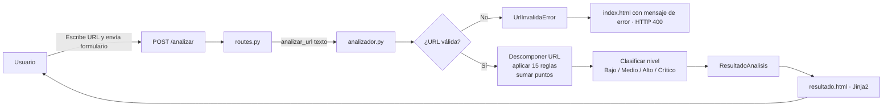
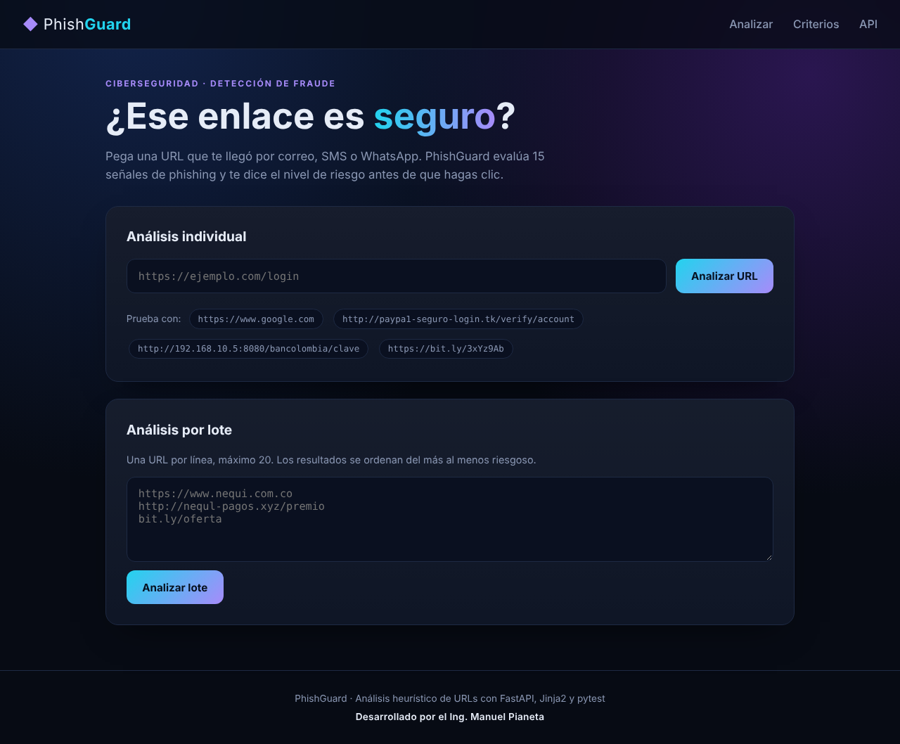
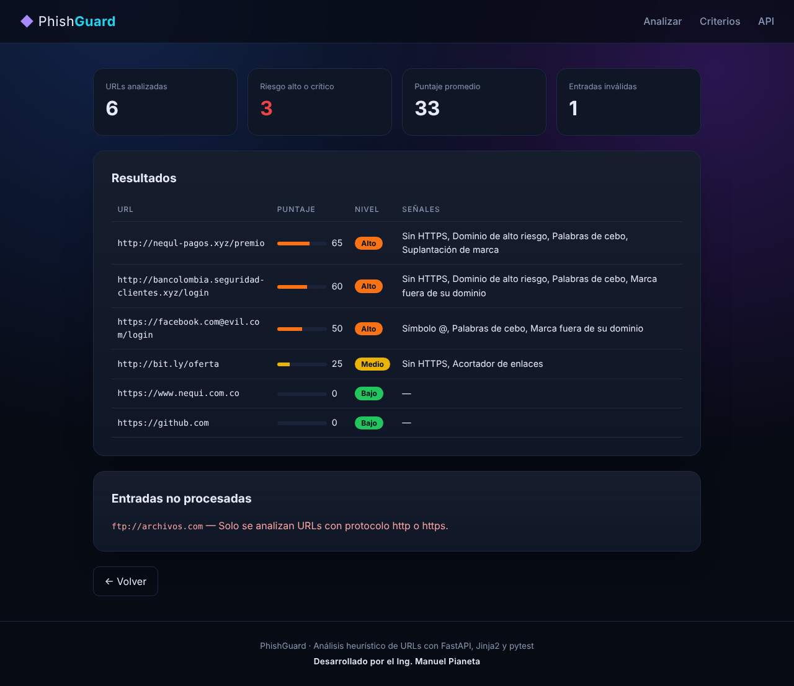

# 🛡️ PhishGuard — Analizador de URLs sospechosas de phishing

> Aplicación web desarrollada con **FastAPI**, **Jinja2** y **pytest** que evalúa enlaces y estima su riesgo de ser fraudulentos antes de que el usuario haga clic.

**Autor:** Manuel Julián Pianeta Calvo — Ingeniería de Sistemas, Institución Universitaria Americana
**Modalidad:** Individual · Proyecto práctico de desarrollo de software

---

## 1. Presentación del proyecto

### Nombre
**PhishGuard**

### Propósito
Ayudar a cualquier persona a decidir si un enlace recibido por correo, SMS o WhatsApp es confiable. El usuario pega la URL y la aplicación devuelve un **puntaje de riesgo de 0 a 100**, un **nivel** (Bajo, Medio, Alto o Crítico), una **recomendación** y la **lista de señales** que encontró.

### Problema que resuelve
El phishing es una de las formas de fraude más comunes en Colombia: mensajes que imitan a bancos (Bancolombia, Davivienda, Nequi, Daviplata) o plataformas (PayPal, Netflix, Microsoft) con enlaces falsos que roban credenciales. La mayoría de usuarios no sabe leer una URL ni detectar trucos como `paypa1.com`, `bancolombia.seguridad-clientes.xyz` o `facebook.com@evil.com`. PhishGuard automatiza esa revisión y la explica en lenguaje sencillo.

### Funcionalidad principal
1. **Análisis individual:** recibe una URL, la valida, la descompone y aplica 15 reglas heurísticas de ciberseguridad.
2. **Análisis por lote:** recibe hasta 20 URLs (una por línea), las analiza, las ordena de mayor a menor riesgo y muestra un resumen con indicadores.
3. **API JSON:** endpoint `POST /api/analizar` para integrar el analizador con otros sistemas.
4. **Página de criterios:** explica cómo se calcula el puntaje.

No es un CRUD: no se guardan registros. La aplicación **procesa información** (análisis de texto, distancia de edición entre cadenas, clasificación por puntaje) y **genera un resultado nuevo** en cada solicitud.

---

## 2. Tecnologías utilizadas

| Tecnología | Función en el proyecto | Por qué se eligió |
|---|---|---|
| **Python 3.11+** | Lenguaje de toda la aplicación | Exigido por el curso; tiene librería estándar fuerte para manejo de URLs |
| **FastAPI** | Framework backend: define rutas, recibe formularios y JSON, devuelve HTML y JSON | Rápido, moderno, valida datos con Pydantic y genera documentación automática en `/docs` |
| **Jinja2** | Motor de plantillas HTML dinámicas | Integrado con FastAPI; permite herencia de plantillas (`base.html`), ciclos, condicionales y filtros |
| **Uvicorn** | Servidor ASGI que ejecuta la aplicación | Servidor recomendado oficialmente para FastAPI |
| **python-multipart** | Lectura de formularios HTML (`Form`) | FastAPI lo requiere para procesar `application/x-www-form-urlencoded` |
| **Pydantic** | Validación del cuerpo JSON de la API | Viene con FastAPI; rechaza automáticamente peticiones mal formadas (422) |
| **pytest** | Pruebas automatizadas | Exigido por el curso; sintaxis simple, fixtures y `parametrize` |
| **httpx** | Cliente HTTP que usa `TestClient` | Requerido por `fastapi.testclient` |
| **urllib.parse / ipaddress / re** (estándar) | Descomponer la URL, detectar IPs y validar con expresiones regulares | No requieren instalación y son confiables |

---

## 3. Arquitectura y organización

```
phishguard/
├── app/
│   ├── __init__.py
│   ├── main.py              ← Crea la app FastAPI, monta /static e incluye las rutas
│   ├── routes.py            ← Rutas de FastAPI (controladores)
│   ├── analizador.py        ← Lógica de negocio: validación, reglas, puntaje
│   ├── templates/           ← Plantillas Jinja2
│   │   ├── base.html        ← Plantilla padre (barra, pie de página)
│   │   ├── index.html       ← Formularios de análisis individual y por lote
│   │   ├── resultado.html   ← Medidor de riesgo y señales detectadas
│   │   ├── lote.html        ← Tabla de resultados y KPIs del lote
│   │   └── criterios.html   ← Explicación de las reglas
│   └── static/
│       └── styles.css       ← Estilos de la interfaz
├── tests/
│   ├── test_analizador.py   ← Pruebas unitarias de la lógica
│   └── test_rutas.py        ← Pruebas de rutas con TestClient
├── evidencias/              ← Capturas de pantalla
├── pytest.ini
├── requirements.txt
└── README.md
```

La separación sigue tres capas:

- **Rutas (`app/routes.py`)**: reciben la petición, llaman a la lógica y eligen qué plantilla mostrar. No contienen reglas de análisis.
- **Lógica (`app/analizador.py`)**: funciones puras (`analizar_url`, `analizar_lote`, `normalizar_url`, `levenshtein`, `dominio_registrado`) que no dependen de FastAPI. Por eso se pueden probar de forma aislada.
- **Presentación (`app/templates/`)**: Jinja2 recibe objetos `ResultadoAnalisis` y los convierte en HTML.

### Rutas de FastAPI

| Método | Ruta | Descripción | Respuesta |
|---|---|---|---|
| GET | `/` | Página principal con formularios | HTML |
| POST | `/analizar` | Analiza una URL enviada por formulario | HTML (200) o error (400) |
| POST | `/lote` | Analiza varias URLs | HTML (200) o error (400) |
| GET | `/criterios` | Explica las reglas | HTML |
| POST | `/api/analizar` | Analiza una URL enviada como JSON `{"url": "..."}` | JSON (200) o error (422) |
| GET | `/salud` | Verificación de estado | JSON |
| GET | `/docs` | Documentación interactiva generada por FastAPI | HTML |

### Uso de Jinja2
- `base.html` define la estructura común con ``; las demás plantillas usan ``.
- `resultado.html` usa la variable `r.puntaje` dentro de un estilo CSS (`--valor`) para dibujar el medidor circular, y el filtro `sort(attribute='puntos', reverse=true)` para ordenar las señales.
- `lote.html` usa ``, `map(attribute='criterio') | join(', ')` y clases CSS dinámicas (`{{ r.clase }}`) para colorear cada nivel.
- `index.html` muestra mensajes de error con `` y conserva lo que escribió el usuario con `value="{{ valor }}"`.
- Jinja2 escapa automáticamente el contenido, evitando que una URL maliciosa inyecte HTML (XSS).

---

## 4. Funcionamiento de la aplicación



### ¿Qué datos recibe?
- **Formulario individual:** campo `url` (texto).
- **Formulario por lote:** campo `urls` (texto con una URL por línea).
- **API:** JSON `{"url": "..."}`.

### ¿Cómo se procesan?
1. **Normalización y validación** (`normalizar_url`): elimina espacios, agrega `http://` si falta el protocolo, rechaza protocolos distintos de http/https, dominios sin punto, puertos inválidos, espacios internos y URLs de más de 2048 caracteres.
2. **Descomposición** con `urllib.parse.urlsplit`: protocolo, host, puerto, usuario (lo que va antes de `@`), ruta y parámetros.
3. **Dominio registrado**: identifica el dominio real considerando sufijos compuestos como `.com.co` o `.gov.co` (`www.bancolombia.com.co` → `bancolombia.com.co`).
4. **Reglas heurísticas** — cada una suma puntos:

| Señal | Puntos |
|---|---|
| Sin HTTPS | 10 |
| Host es una dirección IP | 25 |
| Símbolo `@` en la dirección | 20 |
| URL larga (>75) / muy larga (>100) | 8 / 15 |
| 3 o más subdominios | 15 |
| Extensión de alto riesgo (`.tk`, `.xyz`, `.top`, …) | 15 |
| Punycode (`xn--`) | 20 |
| Acortador (`bit.ly`, `tinyurl.com`, …) | 15 |
| 2 o más guiones en el dominio | 10 |
| 3 o más dígitos en el dominio | 5 |
| Puerto no estándar | 10 |
| `//` dentro de la ruta | 10 |
| Palabras de cebo (`login`, `clave`, `verificar`, `premio`…) | 5 c/u, máx. 20 |
| **Suplantación de marca** (distancia de Levenshtein ≤ 2, ej. `paypa1` ≈ `paypal`) | 30 |
| Marca mencionada fuera de su dominio real | 25 |

5. **Clasificación**: el total se limita a 100 y se asigna el nivel: **Bajo** (0–24), **Medio** (25–49), **Alto** (50–74), **Crítico** (75–100), con una recomendación para cada uno.

El algoritmo de **distancia de Levenshtein** está implementado desde cero con programación dinámica: calcula cuántas inserciones, borrados o sustituciones separan dos palabras. Así se detecta `nequl` (1 cambio respecto a `nequi`) o `paypa1` (1 cambio respecto a `paypal`).

### ¿Qué función cumple FastAPI?
Recibe la petición HTTP, extrae los datos del formulario (`Form`) o del JSON (modelo Pydantic `SolicitudApi`), invoca la lógica, captura las excepciones de validación y devuelve la respuesta con el código HTTP correcto (200, 400 o 422). También sirve los archivos estáticos y genera la documentación en `/docs`.

### ¿Cómo presenta Jinja2 los resultados?
`TemplateResponse` entrega a la plantilla el objeto `ResultadoAnalisis`. Jinja2 dibuja el medidor con el color del nivel, la URL, el host, el dominio real y una tarjeta por cada señal detectada ordenada por gravedad. En el lote muestra 4 indicadores (total, riesgosas, promedio, inválidas) y una tabla con barras de riesgo.

### ¿Qué ocurre si el usuario introduce información incorrecta?
- La lógica lanza `UrlInvalidaError` con un mensaje claro en español.
- La ruta la captura y vuelve a mostrar el formulario con el mensaje en rojo, **conservando lo que escribió** y respondiendo **HTTP 400**.
- En la API se devuelve **HTTP 422** con `{"error": "..."}`; si falta el campo `url`, Pydantic responde 422 automáticamente.
- En el lote, las líneas inválidas no detienen el proceso: se listan aparte en “Entradas no procesadas”.

---

## 5. Instalación y ejecución

### Requisitos
- Python 3.11 o superior
- pip
- Git (para clonar)

### Pasos

```bash
git clone https://github.com/manuelpianeta6393-maker/phishguard.git
cd phishguard

python -m venv venv
# Windows
venv\Scripts\activate
# Linux / macOS
source venv/bin/activate

pip install -r requirements.txt
```

### Iniciar el servidor

```bash
uvicorn app.main:app --reload
```

### Acceder desde el navegador
- Aplicación: <http://127.0.0.1:8000>
- Documentación de la API: <http://127.0.0.1:8000/docs>

### Cómo usarla
1. Pega una URL en **Análisis individual** y pulsa **Analizar URL** (o haz clic en un ejemplo).
2. Revisa el puntaje, el nivel, la recomendación y las señales detectadas.
3. Para varias URLs, pégalas una por línea en **Análisis por lote** y pulsa **Analizar lote**.
4. Desde otro programa:

```bash
curl -X POST http://127.0.0.1:8000/api/analizar \
     -H "Content-Type: application/json" \
     -d "{\"url\": \"http://paypa1-seguro-login.tk/verify/account\"}"
```

---

## 6. Pruebas automatizadas

### Ejecutar

```bash
pytest
```

`pytest.ini` ya configura la carpeta `tests` y el modo detallado (`-v`). Se implementaron **21 funciones de prueba** que, con `parametrize`, generan **30 casos**. Todos pasan.

### Pruebas de la lógica (`tests/test_analizador.py`)

| # | Prueba | Qué comprueba | Datos | Resultado esperado | Obtenido | ¿Éxito? |
|---|---|---|---|---|---|---|
| 1 | `test_url_legitima_tiene_riesgo_bajo` | Funcionalidad principal con URL segura | `https://www.google.com` | Puntaje 0, nivel Bajo, sin señales | Igual | ✅ |
| 2 | `test_url_de_phishing_es_critica` | Funcionalidad principal con phishing | `http://paypa1-seguro-login.tk/verify/account` | Nivel Crítico, ≥ 75, detecta Sin HTTPS, TLD de riesgo y suplantación | 85, Crítico | ✅ |
| 3 | `test_puntaje_esperado_para_ip_con_puerto` | Resultado exacto esperado | `http://192.168.10.5:8080/bancolombia/clave` | 55 puntos (10+25+10+10), Alto | 55, Alto | ✅ |
| 4 | `test_marca_en_subdominio_de_otro_dominio` | Detección de marca fuera de su dominio | `http://bancolombia.seguridad-clientes.xyz/login` | Dominio real `seguridad-clientes.xyz` y señal de marca | Igual | ✅ |
| 5 | `test_arroba_oculta_destino_real` | Truco del `@` | `https://facebook.com@evil.com/login` | Host `evil.com`, señales `@` y marca | Igual | ✅ |
| 6 | `test_url_sin_protocolo_se_normaliza` | Normalización | `bit.ly/3xYz9Ab` | Se convierte a `http://…` y detecta acortador | Igual | ✅ |
| 7 | `test_dominio_colombiano_compuesto` | Sufijos `.com.co` | `www.bancolombia.com.co` | Dominio `bancolombia.com.co`, puntaje 0 | Igual | ✅ |
| 8 | `test_puntaje_nunca_supera_100` | Caso límite | URL con todas las señales | Puntaje exactamente 100 | 100 | ✅ |
| 9–12 | `test_levenshtein` (4 casos) | Algoritmo de distancia | `paypal/paypal`, `paypa1/paypal`, `nequl/nequi`, `""/abc` | 0, 1, 1, 3 | Igual | ✅ |
| 13–19 | `test_entradas_invalidas_lanzan_error` (7 casos) | Datos inválidos | vacía, solo espacios, `ftp://`, sin dominio, con espacios, puerto 99999, >2048 caracteres | `UrlInvalidaError` con mensaje correcto | Igual | ✅ |
| 20 | `test_lote_ordena_y_separa_errores` | Lote: orden y errores | 3 URLs, una inválida y una línea vacía | 2 resultados ordenados por riesgo, 1 error | Igual | ✅ |
| 21 | `test_lote_vacio_o_excedido` | Casos límite del lote | Lote vacío y 21 URLs | `UrlInvalidaError` en ambos | Igual | ✅ |

### Pruebas de rutas FastAPI (`tests/test_rutas.py`, con `TestClient`)

| # | Prueba | Qué comprueba | Datos | Resultado esperado | Obtenido | ¿Éxito? |
|---|---|---|---|---|---|---|
| 22 | `test_pagina_principal_responde` | `GET /` responde | — | 200, HTML, título y pie de autor | Igual | ✅ |
| 23 | `test_formulario_muestra_resultado` | `POST /analizar` muestra el resultado | URL de phishing | 200 y textos “Crítico” y “Suplantación de marca” | Igual | ✅ |
| 24 | `test_formulario_con_url_invalida_muestra_error` | Error controlado en la ruta | `ftp://archivos.com` | 400, mensaje de error y valor conservado | Igual | ✅ |
| 25 | `test_formulario_vacio` | Formulario sin datos | `{}` | 400 y “Debes ingresar una URL.” | Igual | ✅ |
| 26 | `test_lote_muestra_resumen` | `POST /lote` | 2 válidas y 1 inválida | 200, resumen y sección de no procesadas | Igual | ✅ |
| 27 | `test_api_devuelve_json` | `POST /api/analizar` | `https://www.google.com` | 200, JSON con puntaje 0 y nivel Bajo | Igual | ✅ |
| 28 | `test_api_con_url_invalida_devuelve_422` | API con dato inválido | `{"url": ""}` | 422 y JSON de error | Igual | ✅ |
| 29 | `test_api_sin_campo_url` | Validación Pydantic | `{}` | 422 | 422 | ✅ |
| 30 | `test_criterios_y_salud` | Rutas auxiliares y estáticos | — | 200 en `/criterios`, `/salud` y CSS | Igual | ✅ |

**Resultado:** `30 passed` ✅ (ver evidencia 8).

---

## 7. Evidencias de funcionamiento

### Interfaz principal


### Ingreso de una URL sospechosa


### Resultado del procesamiento — URL de phishing (Crítico)


### Resultado del procesamiento — URL legítima (Bajo)


### Análisis por lote


### Validación de entrada incorrecta


### Página de criterios


### Ejecución de las pruebas con pytest


---

## 8. Conclusiones

**Desafíos y soluciones**

- **Identificar el dominio real.** Tomar las dos últimas partes del host fallaba con dominios colombianos (`bancolombia.com.co` quedaba como `com.co`). Se resolvió con un conjunto de sufijos compuestos.
- **Detectar suplantación sin falsos positivos.** Comparar el dominio completo con la marca no detectaba `paypa1-seguro-login`. Se dividió el dominio por guiones y se compara cada fragmento con la distancia de Levenshtein. También se quitaron marcas muy cortas que generaban coincidencias accidentales, y las palabras de cebo no se evalúan en el host cuando el dominio es el oficial de la marca (`accounts.google.com`).
- **Errores amigables.** En lugar de dejar que una excepción rompa la página, se creó `UrlInvalidaError`; las rutas la capturan y devuelven el formulario con el mensaje y el código HTTP adecuado.
- **Pruebas mantenibles.** Separar la lógica de las rutas permitió probar las reglas como funciones normales, y con `parametrize` se cubrieron 7 tipos de entradas inválidas en una sola función.

**Aprendizajes**

- FastAPI permite atender en la misma aplicación una interfaz HTML (formularios + Jinja2) y una API JSON validada con Pydantic, reutilizando la misma lógica.
- Jinja2 con herencia de plantillas evita repetir código y su autoescape protege contra inyección de HTML, algo importante en una aplicación que muestra URLs maliciosas.
- `TestClient` simula peticiones reales sin levantar el servidor, lo que hace que las pruebas sean rápidas (menos de 1 segundo) y confiables.
- Las heurísticas no reemplazan a un servicio de reputación en línea, pero enseñan al usuario **por qué** un enlace es peligroso, que es la mejor defensa contra el phishing.

---

<p align="center"><strong>Desarrollado por el Ing. Manuel Pianeta</strong></p>
